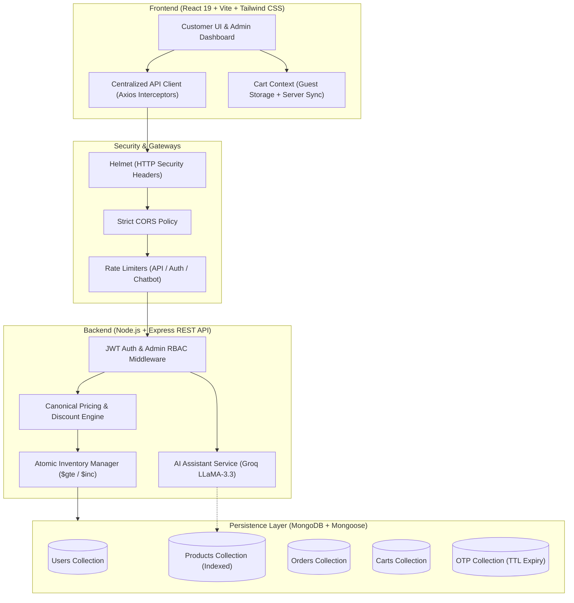
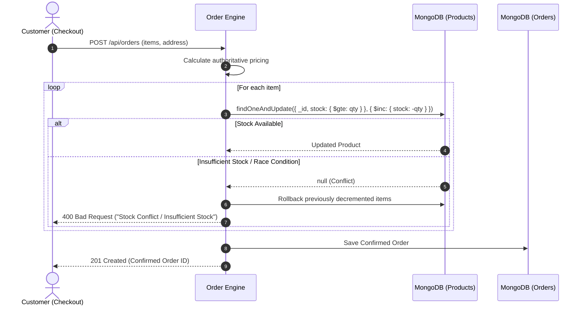

# 🌿 O2 Herbal Care — Production MERN E-Commerce Platform

A production-grade, full-stack MERN (MongoDB, Express, React, Node.js) e-commerce application engineered with authoritative server-side pricing, atomic inventory deduction, HMAC-SHA256 OTP verification, role-based access control (RBAC), and an intelligent AI shopping assistant powered by Groq LLaMA 3.3.

---

## 🏗️ System Architecture



---

## 🔒 Key Engineering & Security Highlights

### 1. Authoritative Server-Side Pricing (Anti-Tampering)
- **Zero Client Trust**: The frontend only transmits product IDs and requested quantities.
- **Dynamic Pricing Engine**: Prices and discount tiers are resolved strictly on the server from MongoDB records.
- **Volume Discount Tiers**:
  - `Subtotal >= ₹2000` $\rightarrow$ **₹200 OFF**
  - `Subtotal >= ₹1500` $\rightarrow$ **₹150 OFF**
  - `Subtotal >= ₹1000` $\rightarrow$ **₹100 OFF**
  - `Subtotal >= ₹500` $\rightarrow$ **₹50 OFF**
  - `Shipping`: Free for orders $\ge$ ₹500; flat ₹50 fee below ₹500.

### 2. Concurrency-Safe Atomic Stock Deduction


### 3. Cryptographic OTP Authentication
- **Secure Generation**: `crypto.randomInt(100000, 1000000)` ensures uniform distribution without predictable pseudo-random seeds.
- **HMAC-SHA256 Hashing**: Plaintext OTPs are never stored in the database. Only HMAC-SHA256 hashes are persisted.
- **Rate-Limiting & Anti-Bruteforce**: 3 maximum attempts per OTP record, with a 60-second cooldown on resends.
- **MongoDB TTL Index**: OTP records automatically expire and delete after 5 minutes via MongoDB TTL indexing.

### 4. Enterprise API Architecture
- Centralized `apiClient.js` with automatic JWT Bearer token injection and normalized error extraction.
- Modularized service contracts: `authApi`, `productApi`, `cartApi`, `orderApi`, `adminApi`, and `chatbotApi`.
- Clean separation: Backend is 100% decoupled from the frontend repository and serves its own database seeds from `backend/data/products.js`.

---

## 📁 Repository Structure

```
├── backend/
│   ├── config/             # Database connection & environment configuration
│   ├── data/               # Seed catalog (products.js) & AI knowledge base
│   ├── middleware/         # JWT auth, Admin RBAC, Rate limiters
│   ├── models/             # Mongoose schemas (User, Product, Order, Cart, OTP)
│   ├── routes/             # REST API controllers & route handlers
│   ├── services/           # Business logic (pricingService.js)
│   ├── tests/              # Unit test suites (pricing, security, validation)
│   ├── seeder.js           # Database catalog seed script
│   └── server.js           # Express app bootstrap & security middlewares
│
├── frontend/
│   ├── src/
│   │   ├── admin/          # Admin portal (dashboard, orders, inventory)
│   │   ├── components/     # Reusable UI components (Navbar, Footer, Modals)
│   │   ├── context/        # React contexts (AuthContext, CartContext)
│   │   ├── pages/          # Application views (Home, Products, Checkout, MyOrders)
│   │   ├── services/       # Centralized API service layer (apiClient, authApi, etc.)
│   │   └── utils/          # Authentication & token utilities
│   └── vite.config.js      # Vite build pipeline
│
└── README.md               # System documentation & deployment manual
```

---

## 🧪 Automated Test Suite

The backend includes native unit test suites covering critical e-commerce logic without heavy third-party runners:

```bash
cd backend
npm test
```

### Test Coverage Summary:
| Test Suite | Focus Area | Verification |
|---|---|---|
| `pricingService.test.js` | Pricing Engine | Discount tier math, effective prices, shipping thresholds |
| `securityAndAuth.test.js` | Cryptography & RBAC | HMAC-SHA256 hashing, bcrypt password validation, JWT signing |
| `validationAndStock.test.js` | Integrity & Concurrency | Address schema sanitization, atomic stock logic, guest cart merge |

---

## 🚀 Getting Started

### Prerequisites
- **Node.js**: v18.0.0 or higher
- **MongoDB**: Local MongoDB instance or MongoDB Atlas URI

### 1. Backend Setup
```bash
cd backend
npm install
```

Create a `.env` file in `backend/` (refer to `.env.example`):
```env
PORT=5000
NODE_ENV=development
MONGO_URI=mongodb://127.0.0.1:27017/o2herbal
JWT_SECRET=your_jwt_secret_here
FRONTEND_URL=http://localhost:5173
GROQ_API_KEY=your_groq_api_key_here
```

Seed the database catalog:
```bash
node seeder.js
```

Start the backend:
```bash
npm run dev
# Server runs on http://localhost:5000
```

### 2. Frontend Setup
```bash
cd ../frontend
npm install
```

Create a `.env` file in `frontend/` (refer to `.env.example`):
```env
VITE_API_URL=http://localhost:5000/api
```

Start the Vite development server:
```bash
npm run dev
# Frontend runs on http://localhost:5173
```

---

## 🛡️ Production Deployment Checklist
1. **Environment Variables**: Configure strong, cryptographically generated `JWT_SECRET` and secure `MONGO_URI`.
2. **CORS Configuration**: Restrict `FRONTEND_URL` to the exact production domain.
3. **Database Indexes**: Verify MongoDB indexes on `Product` (`{ isActive: 1, category: 1 }`), `Order` (`{ user: 1, createdAt: -1 }`), and `OTP` (`{ createdAt: 1 }` TTL).
4. **HTTPS / TLS**: Terminate TLS at the reverse proxy (e.g., NGINX, Cloudflare, Render, AWS ALB).
5. **Rate Limiting**: Rate limits are active out of the box via `express-rate-limit` for DDoS and brute-force mitigation.
